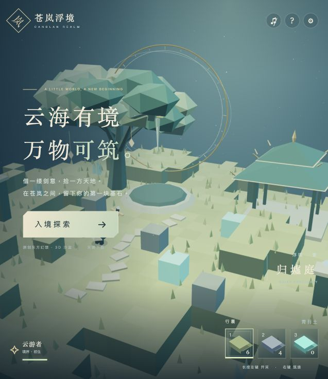

# 苍岚浮境 · Canglan Realm

原创东方幻想 3D 方块探索小作品。云游者带着悬浮灵剑，在古树、亭台和剑阵之间开采、收集、重筑浮岛。

**核心互动：挖 → 掉 → 捡 → 放。** 支持玩家行走、跳跃、第三人称视角、本地存档和低画质模式。

[GitHub 源码](https://github.com/K-BVL/bvl) · [私人试玩（所有者登录）](https://canglan-realm-voxel.basic-ray-0197.chatgpt.site)



## 启动

安装 Node.js 20 或以上版本后，在项目目录执行：

```sh
npm start
```

打开终端输出的 <http://127.0.0.1:4173>。**无需 npm install**，three.js 依赖已包含。Mac 也可以双击 `启动浮境.command`。浏览器 ES Modules 需要 HTTP 服务，不要直接双击 index.html。

## 操作

| 操作 | 输入 |
| --- | --- |
| 移动 / 跳跃 | WASD / 空格 |
| 转向 / 调整视角 | Q、E / 方向键 / 中键拖动 |
| 缩放 | 鼠标滚轮 |
| 开采 | 指向近处方块，持续按左键 |
| 选择物品 | 1、2、3 或点击物品栏 |
| 放置 | 指向方块表面，右键 |
| 回到出生点 / 说明 | R / H |

土块需要 0.75 秒，石块 2 秒，晶石 1.4 秒。松手或换目标立即重置裂痕。微型掉落物会自转并落地；走近 3 格后吸附，抵达后对应库存 +1。右键放置消耗一个，零库存不可放置。

初始库存为土 6、石 4、晶 0。一次开采、捡回、放回同种材料后，库存回到起始数量。存档只保存在当前浏览器与当前网址，不会跨设备同步。刷新保留改动，设置里可主动保存或两次确认后重建世界。

## 检查与构建

```sh
npm test
npm run build
```

25 项领域测试涵盖开采计时、重置、地面碰撞、3 格边界、单次入库、放置、库存守恒、存档、世界范围及玩家跳跃。静态产物输出到 `dist/`，可部署到任意静态主机。测试报告见 [docs/VALIDATION.md](docs/VALIDATION.md)。

## 作业文件

- [BRIEF.md](BRIEF.md)：目标、用户要求、原创点子与边界。
- [VERIFY.md](VERIFY.md)：预期验收行为，不用来填写或美化实际结果。
- [PLANS.v1.md](PLANS.v1.md)：初版方案的交付时整理。
- [PLANS.md](PLANS.md)：实施步骤和调整。
- [AGENTS.md](AGENTS.md)：协作规则。
- `src/game.mjs`：纯模拟、体素、碰撞、库存与存档。
- `src/scene.mjs`：原创几何、合并地形、角色、掉落显示与特效。
- `src/main.mjs`：输入、界面、声音和持久化。
- `tests/game.test.mjs`：可复现领域测试。

## 技术与证据边界

固定使用 [three.js 0.180.0](https://www.npmjs.com/package/three/v/0.180.0)。使用合并几何、草丛实例化、受限像素比和流畅模式控制渲染成本。**未知旧电脑上的 30 FPS 尚未实测，不作保证。** 触控提供辅助操作，主要针对桌面键鼠验收。

所有模型与效果为程序原创；仅取东方幻想氛围作为视觉方向，不使用商业作品素材。本作品没有联机、战斗、合成、天气系统或真实大型开放世界。编辑范围每轴最多 32 格。景观建筑为装饰，实体碰撞以可编辑方块为准。

three.js 原许可证保留在 `vendor/THREE-LICENSE.txt`。无需外部图片、字体、音频服务或任何账号凭证运行。
